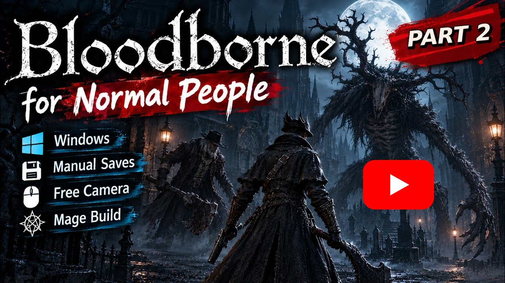
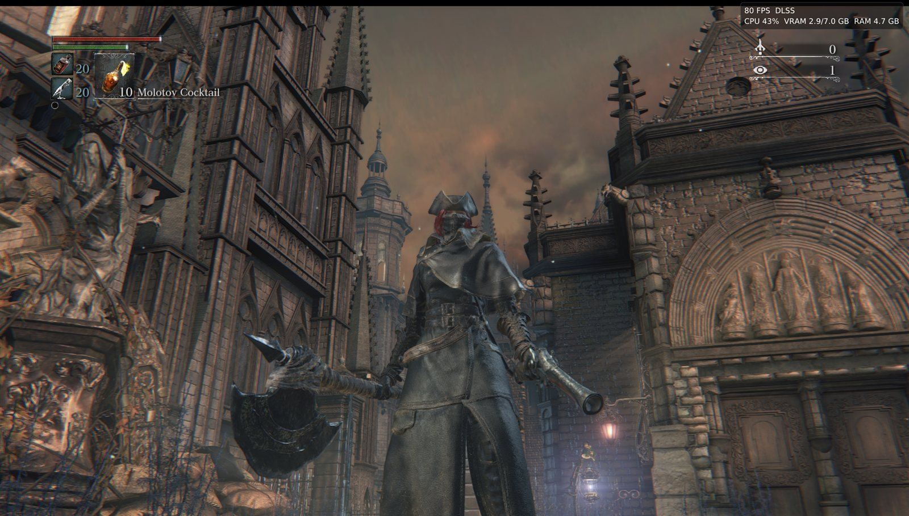
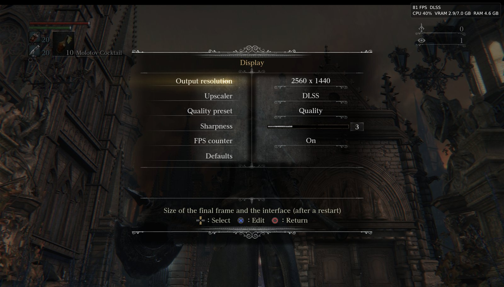
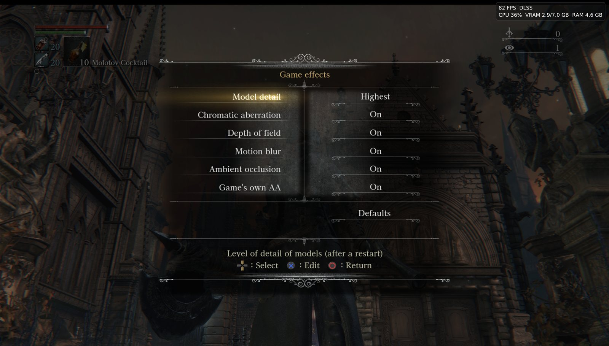
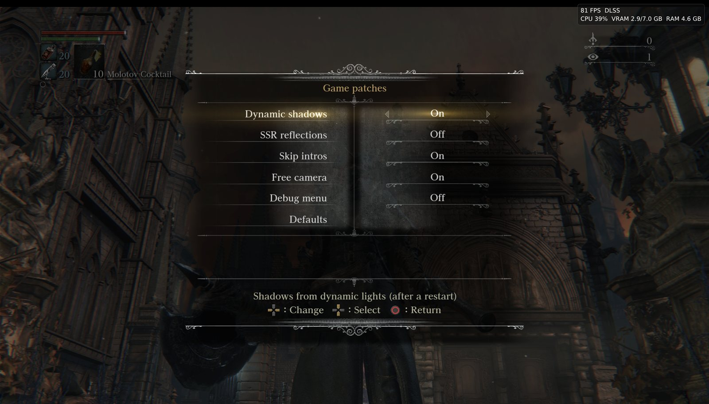
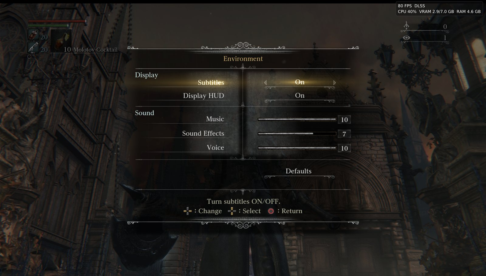
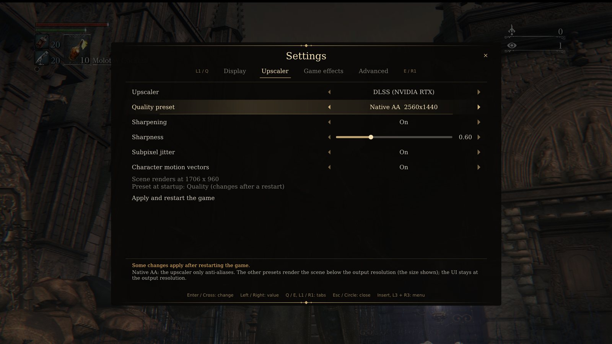

**English** | [Русский](README.ru.md)

# Bloodborne Windows Native

### 🛡️ Stable · 🖱️ Mouse and keyboard · 💾 Save anywhere · DLSS · FSR 4 · up to 4K

- **Stability first:** developed with crash-free play in mind: long sessions without crashes,
  also on graphics cards with 4 GB of memory. Every crash report is tracked down and fixed.
- **Mouse and keyboard:** the mouse turns the camera directly, as in PC games; every key can be
  rebound.
- **Save copies:** save your progress at any moment and load any copy back without restarting
  the game. Where: in the game's own pause menu (Options → **Saves**), in the port's menu
  (**Insert**, on a gamepad **L3 + R3** → **Saves** tab), or with **F5** (save) / **F8** (load the
  newest).
- **Cheats**, switched on and off at once: in the game's System menu (**Cheats**) and in the
  port's menu (**Cheats** tab). See [Cheats](#cheats).
- **DLSS, FSR 4, FSR 3.1**, output up to 4K, unlocked frame rate.

<br>

<h2 align="center">⬇️ <a href="https://github.com/RandomAlien0x33/bloodborne-win-native/releases/latest">Download the latest version</a></h2>

<p align="center">
<a href="https://github.com/RandomAlien0x33/bloodborne-win-native/releases/latest"></a>
<br>
Windows 10/11 · 116 MB · no game files included
</p>

> [!IMPORTANT]
> **Found a bug or had a crash? Send the log to [Issues](https://github.com/RandomAlien0x33/bloodborne-win-native/issues/new).** Every log sent is looked
> into; without it the cause of a crash cannot be found. How:
> 1. Right after the crash, **before starting the game again**, take the file `out\last-run.log`
>    from the port's folder (every start overwrites the logs).
> 2. Open a [new issue](https://github.com/RandomAlien0x33/bloodborne-win-native/issues/new): what happened and where in the game, the port's version, the
>    graphics card, the memory mode.
> 3. Drag the log file into the issue.

> [!CAUTION]
> **Graphics card with 4 GB of memory or less, or low FPS?** If the game crashes, the frame rate
> is low or drops sharply after a while of playing, try the other memory modes: in the game's menu
> **System → Additional → Memory mode** (or the port's menu, Insert) choose **Hybrid**, and if
> that does not help, **Experimental 1**. The game needs a restart after the change.

<br>

<p>
<a href="https://www.youtube.com/watch?v=JUkWqngg8r4"></a>
<a href="https://www.youtube.com/watch?v=Ur6xRP0DrAA"></a>
</p>

<p>
<a href="https://www.youtube.com/watch?v=lZabKv_oRko"></a>
<a href="https://www.youtube.com/watch?v=jj1LN3LUq0E"></a>
</p>

**▶ Watch on YouTube: [installation guide](https://www.youtube.com/watch?v=JUkWqngg8r4) · [gameplay demo](https://www.youtube.com/watch?v=Ur6xRP0DrAA) · [playthrough, part 1](https://www.youtube.com/watch?v=lZabKv_oRko) · [playthrough, part 2](https://www.youtube.com/watch?v=jj1LN3LUq0E)**

A Windows port of *Bloodborne* (PlayStation 4, version 1.09), based on the
**[Linux port by deadinside28](https://github.com/deadinside28/bloodborne_pc)**.

The game's original executable runs on a Windows PC, a
runtime written for this game takes the place of the PS4 system libraries, and the graphics are
translated to Vulkan.

> **No game files are included.** You need your own dump of Bloodborne CUSA03173, version
> 1.09. Bloodborne is a trademark of Sony Interactive
> Entertainment; this project is not affiliated with Sony or FromSoftware.














## Features

- **Upscaling:** NVIDIA DLSS (RTX cards), AMD FSR 3.1 and FSR 4, TAA; output up to 4K.
- **Frame rate:** unlocked, 60 or 90 FPS (community patches).
- **Settings in the game's own System menu** (Display, Game effects, Additional) and in the
  port's menu (**Insert** or L3+R3).
- **Mouse and keyboard:** the mouse turns the camera directly, as in PC games.
- **Memory modes:** Classic (most tested), Hybrid (faster on graphics cards; the best on 4 GB cards) and Experimental 1 (graphics memory never grows past the budget; slower).
- **Save copies** from the pause menu and with F5 / F8 (see [Saves](#saves)).
- **Cheats** in the System menu and the port's menu (see [Cheats](#cheats)).
- The port's menus in the game's language (English or Russian).
- Safe saves, mods without changing the game files, game effects on and off.

## Requirements

- Windows 10 (1803 or newer) or 11, 64-bit.
- A graphics card with Vulkan 1.3. DLSS: NVIDIA RTX 20 series or newer.
- Bloodborne CUSA03173 with the 1.09 update, decrypted (the folder with `eboot.bin`, `sce_module`, `sce_sys`, `dvdroot_ps4`).

## Getting started

1. [Download the latest version](https://github.com/RandomAlien0x33/bloodborne-win-native/releases/latest) (the `.zip` file under Assets) and unpack it.
2. In `bbport.ini` set the game folder:
   ```ini
   game_dir=D:\Games\CUSA03173
   save_dir=
   ```
   `save_dir` is optional: the folder for saves. Empty: `user` next to the port.
   Or leave `game_dir` empty and put the `CUSA03173` folder next to `Bloodborne.cmd`.
3. Start `Bloodborne.cmd`.

The release package already has NVIDIA's `nvngx_dlss.dll` for DLSS. A build from source needs it
next to `out\bb-probe.exe`: `bash tools/fetch_dlss.sh` downloads it from NVIDIA's DLSS SDK (it is
not part of this repository).

## Controls

| Keyboard / mouse | PS4 |
|---|---|
| WASD | left stick |
| mouse (or arrow keys) | camera |
| left / right / middle mouse button | R1 / R2 / R3 |
| Space / Left Shift / E / Q | Cross / Circle / Square / Triangle |
| 1 / 3 / R / F | L1 / R1 / L2 / R2 |
| Z / C | L3 / R3 |
| I / K / J / L | d-pad |
| Enter / Tab | Options / touchpad |
| F5 / F8 | save a copy / load the newest copy (press twice) |
| F11 | fullscreen |
| **Insert** (gamepad: **L3 + R3** together) | **the port's menu** |
| click in the window / hold Left Alt | the window holds the cursor / frees it |

Gamepads work through SDL.

### Rebinding keys

1. Close the game.
2. Open `bbport.ini` in the port's folder (next to `Bloodborne.cmd`) in Notepad.
3. Add lines `key.PS4_BUTTON=KEY` at the end. For several keys, separate them with commas (up
   to 4).
4. Save the file and start the game.

```ini
key.r1=mouse_left
key.r2=mouse_right
key.circle=Left Shift,mouse_x1
key.l1=mouse_x2
key.square=E
```

Case does not matter. A line replaces all default keys and mouse buttons of that button: after
`key.l1=mouse_x2` the 1 key is no longer L1. To keep the old key, list it too: `key.l1=1,mouse_x2`.
`key.` lines do not change the gamepad.

**PS4 buttons** (after `key.`):
- `cross`: Cross, action (default Space)
- `circle`: Circle, dodge, run while held (Left Shift)
- `square`: Square, quick item (E)
- `triangle`: Triangle, blood vial (Q)
- `l1`: L1, transform weapon (1)
- `r1`: R1, attack (3 and the left mouse button)
- `l2`: L2, firearm (R)
- `r2`: R2, strong attack (F and the right mouse button)
- `l3`: L3, jump while running (Z)
- `r3`: R3, lock on (C and the middle mouse button)
- `options`: menu (Return)
- `touchpad`: touchpad, gestures (Tab)
- `up`, `down`, `left`, `right`: d-pad (I, K, J, L)
- `move_up`, `move_down`, `move_left`, `move_right`: walking (W, S, A, D)
- `look_up`, `look_down`, `look_left`, `look_right`: camera (arrow keys)
- `move_slow`: walk slowly while held (Left Ctrl); keyboard only. Left Alt is taken: held, it frees the mouse cursor

**Mouse:** `mouse_left`, `mouse_right`, `mouse_middle` (wheel click), `mouse_x1` (side "back"),
`mouse_x2` (side "forward"). The scroll wheel can't be bound.

**Keyboard** (write exactly like this):
- letters `A` … `Z`, top-row digits `0` … `9`, `F1` … `F12`
- `Space`, `Return` (Enter), `Escape`, `Tab`, `Backspace`, `CapsLock`
- `Left Shift`, `Right Shift`, `Left Ctrl`, `Right Ctrl`, `Right Alt`
- arrows `Up`, `Down`, `Left`, `Right`
- `Insert`, `Delete`, `Home`, `End`, `PageUp`, `PageDown`
- numpad: `Keypad 0` … `Keypad 9`, `Keypad Enter`, `Keypad +`, `Keypad -`, `Keypad *`,
  `Keypad /`, `Keypad .`
- symbols `` ` `` `-` `=` `[` `]` `;` `'` `.` `/` `\`

The comma can't be bound: it separates keys in a line. Better leave the port's keys (F5, F8,
F11, Insert, Left Alt) free: they keep doing their own thing.

**Gamepad:** the same with `pad.` instead of `key.`. The right side names the button's place on
the gamepad, Xbox style:
- `a`: bottom (Cross on PS), `b`: right (Circle), `x`: left (Square), `y`: top (Triangle)
- `leftshoulder`, `rightshoulder`: L1, R1
- `lefttrigger`, `righttrigger`: L2, R2
- `leftstick`, `rightstick`: L3, R3 (stick clicks)
- `start`, `back`, `touchpad`
- `dpup`, `dpdown`, `dpleft`, `dpright`: d-pad

Example: `pad.circle=a` and `pad.cross=b` swap the bottom and right buttons: dodge on the bottom
one, action on the right one.

If a key does not work, look for a `controls: unknown` line in `out\last-run.log`: it names the
wrong key.

## Saves

Bloodborne has a single autosave. The port adds copies of your own:

- **Pause menu → Saves** (after System): **Save** copies your progress as it is now; **Load**
  lists the game's autosave and your copies, each with the date and the place.
- **F5** saves a copy, **F8** loads the newest one. The port's menu (**Insert** or **L3 + R3**) has a **Saves**
  tab as well.
- A load needs no restart: the game goes to the title screen and continues from the copy by
  itself, in a few seconds.
- A load row loads on the second press, so a stray press does nothing. A load asked for during a
  loading screen waits until it ends.
- **Undo the last load** brings back the state from before the last load.
- The 15 newest copies are kept, in `user\saves`. Saving a copy never changes the game's own save.
  In `bbport.ini`: `save_copies` (how many), `quicksave_key`, `quickload_key` (e.g. `Ctrl+S`).


## Cheats

In the game's pause menu: Options → System → **Cheats**; in the port's menu (**Insert**, on a
gamepad **L3 + R3**): the **Cheats** tab. They work at once, without a restart, and stay on until
switched off (`bbport.ini`).

| Cheat | What it does |
|---|---|
| Infinite health | Health never runs out |
| Infinite stamina | Stamina never runs out |
| Infinite Blood Echoes | Blood Echoes are set to 99,999,999 |
| Infinite Insight | Insight is set to 99,999,999 |
| Infinite items | A used item's count is set to 20 |
| One-hit kills | Enemies die from one hit |

> What a cheat has set stays in the save after it is switched off: Blood Echoes, Insight (a lot
> of Insight changes the world: enemies, sounds, frenzy), item counts. Save a copy (**F5**) before
> turning cheats on: loading it brings everything back.

## Logs

Each start writes its log to `out\last-run.log` (the one before it: `out\prev-run.log`). The two
launchers differ only in how much goes there:

| Launcher | Log |
|---|---|
| `Bloodborne.cmd` | Everything the game and the port print. |
| `Bloodborne-fulllog.cmd` | Everything plus frame, GPU and memory statistics (a little slower). |

When reporting a problem, attach `out\last-run.log`; if asked, start the game with the launcher
named and repeat what led to it.

## Building from source

**Setup program:** `setup.bat` installs MSYS2 and the packages, gets the sources and builds the
port in one window.

By hand:

1. Install [MSYS2](https://www.msys2.org) to `C:\msys64`, update it (`pacman -Syu` until nothing
   is left) and install the packages:
   ```
   pacman -S --needed git mingw-w64-clang-x86_64-{clang,lld,libc++,cmake,ninja,pkgconf,python,sdl3,boost,fmt,glslang,spirv-cross,spirv-headers,vulkan-headers,vulkan-loader,vulkan-memory-allocator,xxhash,zydis,robin-map,ffmpeg}
   ```
   `vulkan-headers` must be 1.4.350 or newer.
2. `git clone --recursive https://github.com/RandomAlien0x33/bloodborne-win-native`
3. `run.bat --game-dir D:\Games\CUSA03173`: the first start builds `out\bb-probe.exe`
   (`build.sh` in the CLANG64 environment), then starts the game.

## Credits

- **[deadinside28](https://github.com/deadinside28/bloodborne_pc)**: the Linux port this
  Windows port is built on.
- **[yumlevi](https://github.com/yumlevi/bloodborne_pc)**

## License

GPL-2.0-or-later (see `LICENSE`). Bundled components keep their own licenses (shadPS4's video
core: GPL-2.0-or-later; the DLSS bridge in `gpu/dlss_bridge`: MIT). NVIDIA DLSS and AMD FidelityFX
binaries are not part of this repository.

NVIDIA DLSS is a technology of NVIDIA Corporation. The release package includes NVIDIA's
`nvngx_dlss.dll`, unmodified, under the NVIDIA DLSS SDK license (`out\LICENSE-DLSS-SDK.txt` in the
package).
