[English](README.md) | **Русский**

# Bloodborne Windows Native

### 🖱️ Мышь и клавиатура · 💾 Сохранение в любой момент · DLSS · FSR 4 · до 4K

- **Мышь и клавиатура:** мышь поворачивает камеру напрямую, как в PC-играх; любую клавишу можно
  переназначить.
- **Копии сохранений:** сохраняйте прогресс в любой момент и загружайте любую копию без
  перезапуска игры. Где: в меню паузы самой игры (Options → **Сохранения**), в меню порта
  (**Insert**, на геймпаде **L3 + R3** → вкладка **Сохранения**) или клавишами **F5** (сохранить) /
  **F8** (загрузить последнюю).
- **Читы**, включаются и выключаются сразу: в меню System самой игры (**Читы**) и в меню порта
  (вкладка **Читы**). См. [Читы](#читы).
- **DLSS, FSR 4, FSR 3.1**, вывод до 4K, FPS без ограничения.

<br>

<h2 align="center">⬇️ <a href="https://github.com/RandomAlien0x33/bloodborne-win-native/releases/latest">Скачать последнюю версию</a></h2>

<p align="center">
<a href="https://github.com/RandomAlien0x33/bloodborne-win-native/releases/latest"></a>
<br>
Windows 10/11 · 116 МБ · файлов игры нет
</p>

> [!CAUTION]
> **Видеокарта с памятью 4 ГБ и меньше?** Если игра вылетает или FPS резко падает через какое-то
> время игры, попробуйте другие режимы памяти: в меню игры **Система → Дополнительно → Режим
> памяти** (или в меню порта, Insert) выберите **Гибрид**, а если не поможет —
> **Экспериментальный 1**. После смены режима игру нужно перезапустить.

<br>

<p>
<a href="https://www.youtube.com/watch?v=Ur6xRP0DrAA">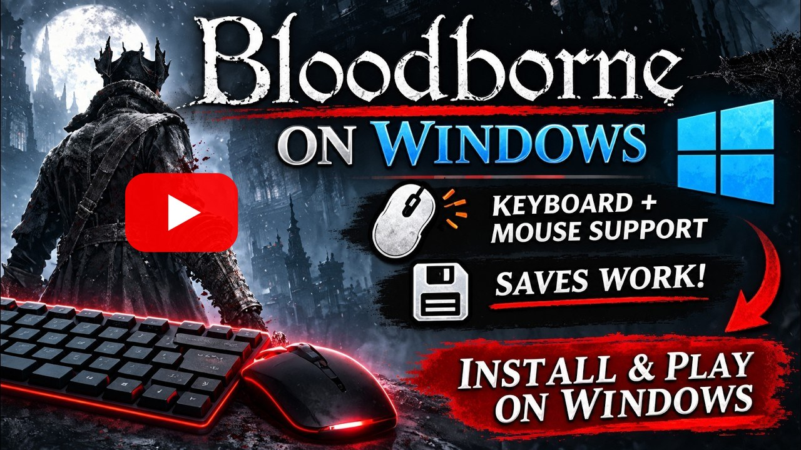</a>
<a href="https://www.youtube.com/watch?v=JUkWqngg8r4">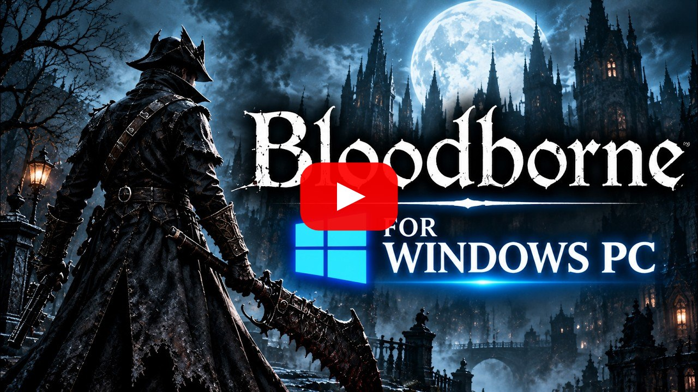</a>
<a href="https://www.youtube.com/watch?v=lZabKv_oRko">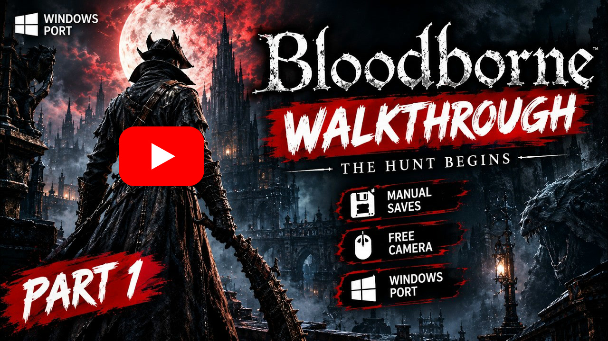</a>
</p>

**▶ Смотреть на YouTube: [новое видео](https://www.youtube.com/watch?v=Ur6xRP0DrAA) · [первое видео](https://www.youtube.com/watch?v=JUkWqngg8r4) · [прохождение на этом порте](https://www.youtube.com/watch?v=lZabKv_oRko)**

Нативный порт *Bloodborne* (PlayStation 4, версия 1.09) для Windows на основе
**[bbport](https://github.com/deadinside28/bloodborne_pc)** от deadinside28.

Оригинальный исполняемый файл игры
запускается прямо на ПК, системные библиотеки PS4 заменяет рантайм, написанный под эту игру, а
графика переводится в Vulkan.

> **Файлов игры здесь нет.** Нужна своя копия Bloodborne CUSA03173 версии 1.09.
> Bloodborne — торговая марка Sony Interactive Entertainment; проект не связан
> с Sony и FromSoftware.

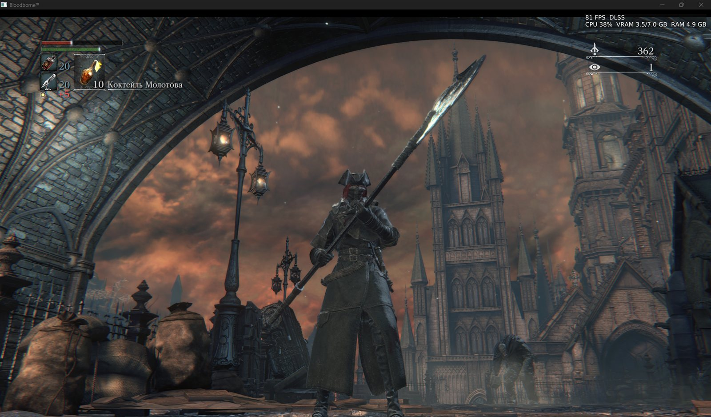

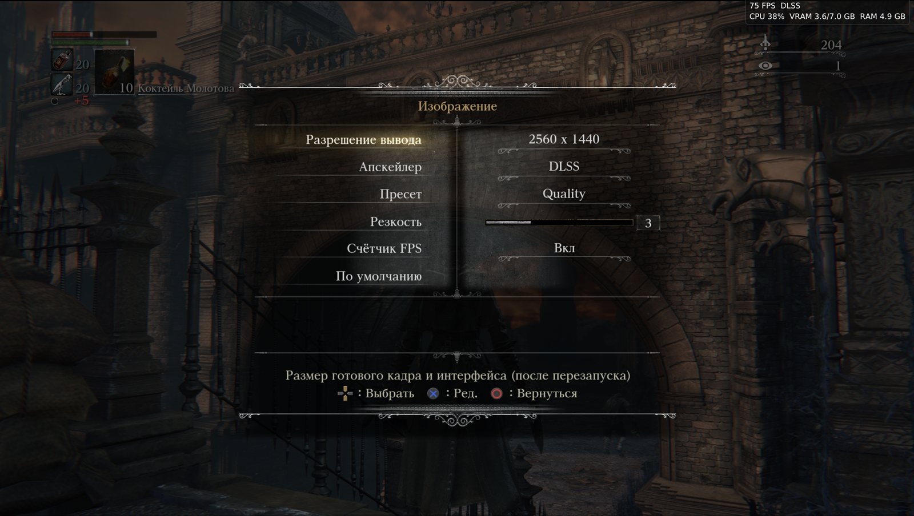

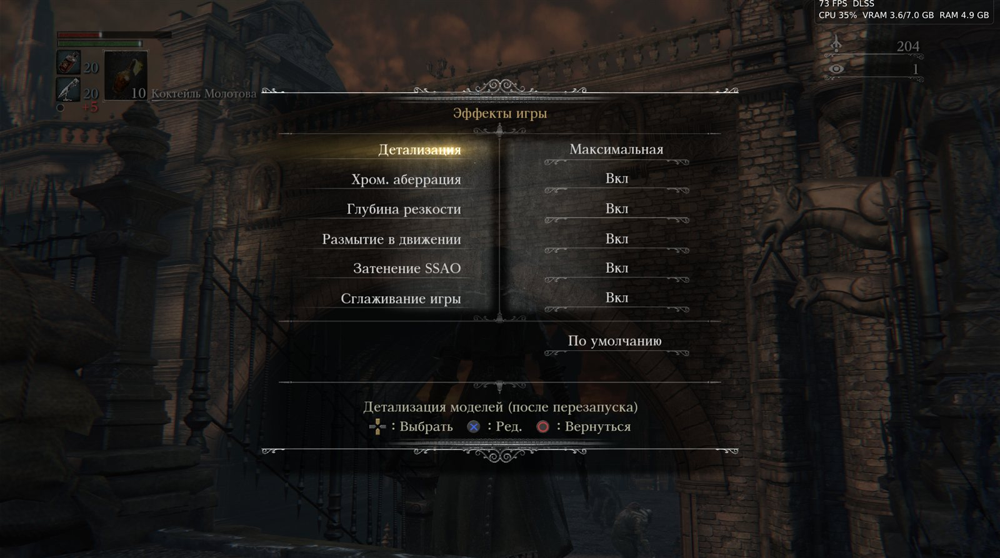

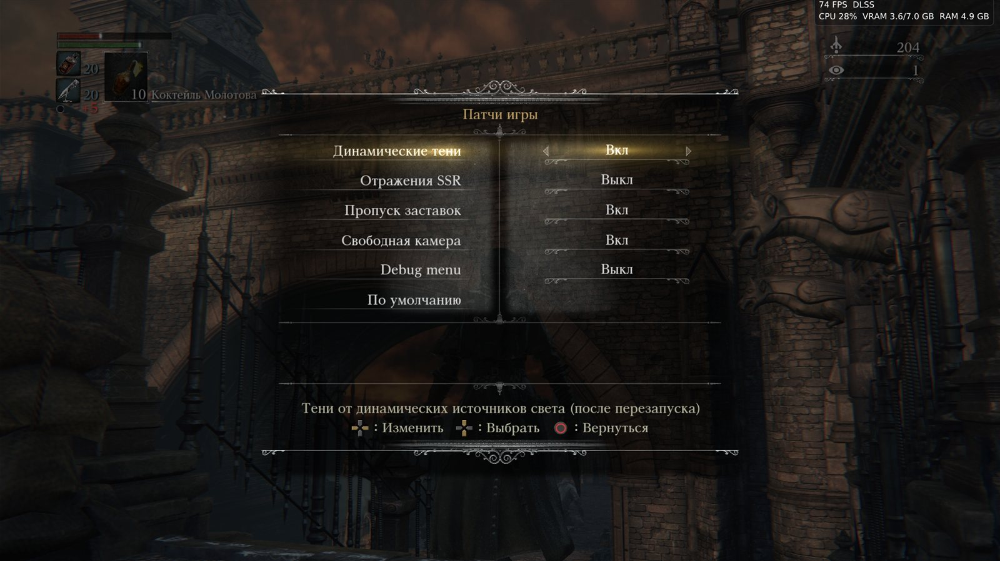

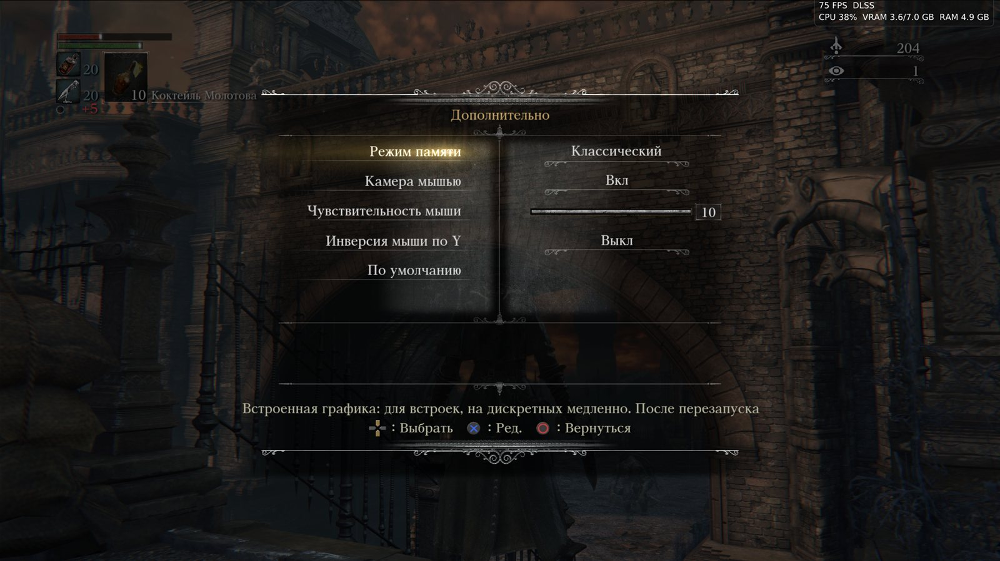

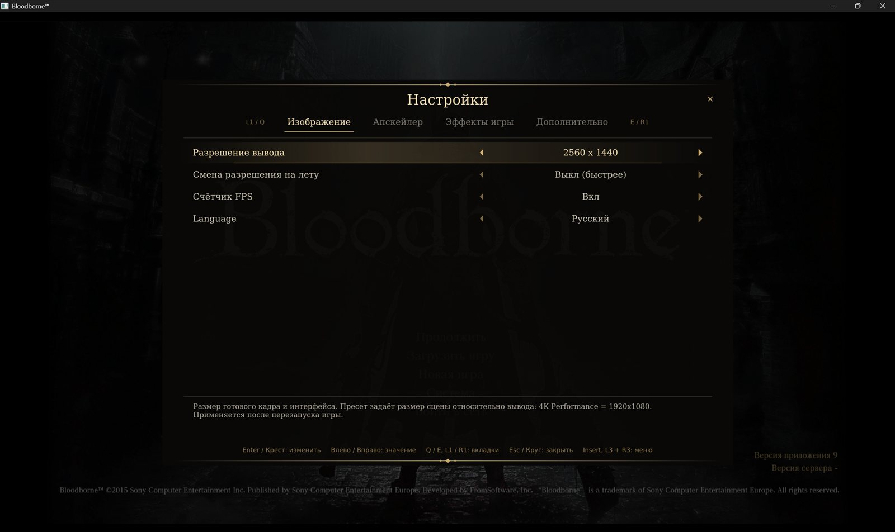

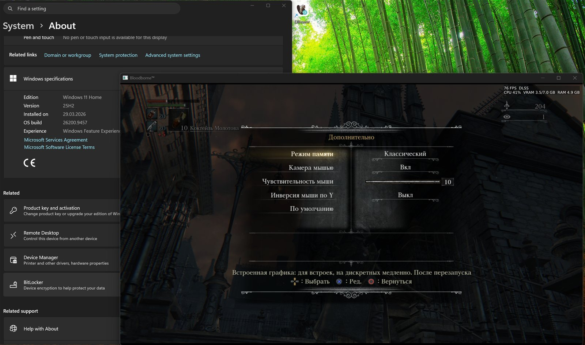

## Возможности

- **Апскейлинг:** NVIDIA DLSS (карты RTX), AMD FSR 3.1 и FSR 4, TAA; вывод до 4K.
- **Частота кадров:** без ограничения, 60 или 90 FPS (патчи сообщества).
- **Настройки в собственном меню игры** System (Изображение, Эффекты игры, Дополнительно) и в
  меню порта (**Insert** или L3+R3).
- **Мышь и клавиатура:** мышь поворачивает камеру напрямую, как в PC-играх.
- **Режимы памяти:** Классический (самый проверенный), Гибрид (быстрее на видеокартах; лучший на картах с 4 ГБ) и Экспериментальный 1 (видеопамять не растёт сверх бюджета; медленнее).
- **Копии сохранений** из меню паузы и клавишами F5 / F8 (см. [Сохранения](#сохранения)).
- **Читы** в меню System и в меню порта (см. [Читы](#читы)).
- Меню порта на языке игры (русский или английский).
- Защищённые сейвы, моды без изменения файлов игры, включение и выключение эффектов игры.

## Требования

- Windows 10 (1803 и новее) или 11, 64 бита.
- Видеокарта с Vulkan 1.3. DLSS: NVIDIA RTX 20-й серии и новее.
- Bloodborne CUSA03173 с обновлением 1.09, расшифрованная (папка с `eboot.bin`, `sce_module`, `sce_sys`, `dvdroot_ps4`).

## Как запустить

1. [Скачайте последнюю версию](https://github.com/RandomAlien0x33/bloodborne-win-native/releases/latest) (файл `.zip` в разделе Assets) и распакуйте.
2. Укажите папку игры в `bbport.ini`:
   ```ini
   game_dir=D:\Games\CUSA03173
   save_dir=
   ```
   `save_dir` необязателен: папка для сейвов. Пусто — `user` рядом с портом.
   Или оставьте `game_dir` пустым и положите папку `CUSA03173` рядом с `Bloodborne.cmd`.
3. Запустите `Bloodborne.cmd`.

В релизном пакете `nvngx_dlss.dll` от NVIDIA для DLSS уже есть. Для сборки из исходников он нужен
рядом с `out\bb-probe.exe`: `bash tools/fetch_dlss.sh` скачивает его из DLSS SDK NVIDIA (в этом
репозитории его нет).

## Управление

| Клавиатура / мышь | PS4 |
|---|---|
| WASD | левый стик |
| мышь (или стрелки) | камера |
| левая / правая / средняя кнопка мыши | R1 / R2 / R3 |
| Пробел / левый Shift / E / Q | Крест / Круг / Квадрат / Треугольник |
| 1 / 3 / R / F | L1 / R1 / L2 / R2 |
| Z / C | L3 / R3 |
| I / K / J / L | крестовина |
| Enter / Tab | Options / тачпад |
| F5 / F8 | сохранить копию / загрузить последнюю копию (нажать дважды) |
| F11 | полный экран |
| **Insert** (на геймпаде **L3 + R3** вместе) | **меню порта** |
| клик в окне / удерживать левый Alt | окно захватывает курсор / отпускает его |

Геймпады работают через SDL.

### Переназначение клавиш

1. Закройте игру.
2. Откройте `bbport.ini` в папке порта (рядом с `Bloodborne.cmd`) Блокнотом.
3. Допишите в конец строки `key.КНОПКА_PS4=КЛАВИША`. Если клавиш несколько, перечислите их через
   запятую (до 4).
4. Сохраните файл и запустите игру.

```ini
key.r1=mouse_left
key.r2=mouse_right
key.circle=Left Shift,mouse_x1
key.l1=mouse_x2
key.square=E
```

Регистр не важен. Строка полностью заменяет стандартные клавиши и кнопки мыши этой кнопки:
после `key.l1=mouse_x2` клавиша 1 больше не L1. Чтобы оставить старую клавишу, впишите и её:
`key.l1=1,mouse_x2`. Геймпад строки `key.` не меняют.

**Кнопки PS4** (после `key.`):
- `cross`: Крест, действие (стандартно Space)
- `circle`: Круг, уклонение, при удержании бег (Left Shift)
- `square`: Квадрат, быстрый предмет (E)
- `triangle`: Треугольник, флакон крови (Q)
- `l1`: L1, трансформация оружия (1)
- `r1`: R1, обычная атака (3 и левая кнопка мыши)
- `l2`: L2, огнестрельное оружие (R)
- `r2`: R2, сильная атака (F и правая кнопка мыши)
- `l3`: L3, прыжок на бегу (Z)
- `r3`: R3, захват цели (C и средняя кнопка мыши)
- `options`: меню (Return)
- `touchpad`: тачпад, жесты (Tab)
- `up`, `down`, `left`, `right`: крестовина (I, K, J, L)
- `move_up`, `move_down`, `move_left`, `move_right`: ходьба (W, S, A, D)
- `look_up`, `look_down`, `look_left`, `look_right`: камера (стрелки)

**Мышь:** `mouse_left`, `mouse_right`, `mouse_middle` (нажатие колеса), `mouse_x1` (боковая
«назад»), `mouse_x2` (боковая «вперёд»). Прокрутку колеса назначить нельзя.

**Клавиатура** (пишите точно так):
- буквы `A` … `Z` (английская раскладка), цифры верхнего ряда `0` … `9`, `F1` … `F12`
- `Space` (пробел), `Return` (Enter), `Escape`, `Tab`, `Backspace`, `CapsLock`
- `Left Shift`, `Right Shift`, `Left Ctrl`, `Right Ctrl`, `Right Alt`
- стрелки `Up`, `Down`, `Left`, `Right`
- `Insert`, `Delete`, `Home`, `End`, `PageUp`, `PageDown`
- цифровой блок: `Keypad 0` … `Keypad 9`, `Keypad Enter`, `Keypad +`, `Keypad -`, `Keypad *`,
  `Keypad /`, `Keypad .`
- символы `` ` `` `-` `=` `[` `]` `;` `'` `.` `/` `\`

Запятую назначить нельзя: она разделяет клавиши в строке. Клавиши порта (F5, F8, F11, Insert,
левый Alt) лучше не занимать: они продолжат делать своё.

**Геймпад:** так же, но `pad.` вместо `key.`. Справа пишется место кнопки на геймпаде по
раскладке Xbox:
- `a`: нижняя (Крест на PS), `b`: правая (Круг), `x`: левая (Квадрат), `y`: верхняя (Треугольник)
- `leftshoulder`, `rightshoulder`: L1, R1
- `lefttrigger`, `righttrigger`: L2, R2
- `leftstick`, `rightstick`: L3, R3 (нажатие стиков)
- `start`, `back`, `touchpad`
- `dpup`, `dpdown`, `dpleft`, `dpright`: крестовина

Пример: `pad.circle=a` и `pad.cross=b` меняют местами нижнюю и правую кнопки: уклонение будет на
нижней, действие — на правой.

Если клавиша не работает, найдите в `out\last-run.log` строку `controls: unknown`: в ней будет
неверное название.

## Сохранения

В Bloodborne одно автосохранение. Порт добавляет ваши собственные копии:

- **Меню паузы → Сохранения** (после «Система»): **Сохранить** делает копию прогресса в
  нынешнем виде; **Загрузить** показывает автосохранение игры и ваши копии с датой и местом.
- **F5** сохраняет копию, **F8** загружает последнюю. В меню порта (**Insert** или **L3 + R3**) тоже есть вкладка
  **Сохранения**.
- Загрузка не требует перезапуска: игра сама выходит в главное меню и продолжает с копии, за
  несколько секунд.
- Строка загрузки срабатывает со второго нажатия, так что случайное нажатие ничего не сделает.
  Загрузка, выбранная во время экрана загрузки, подождёт его окончания.
- **Отменить последнюю загрузку** возвращает состояние до последней загрузки.
- Хранятся 15 последних копий, в `user\saves`. Сохранение копии не меняет собственное сохранение
  игры. В `bbport.ini`: `save_copies` (сколько хранить), `quicksave_key`, `quickload_key`
  (например, `Ctrl+S`).

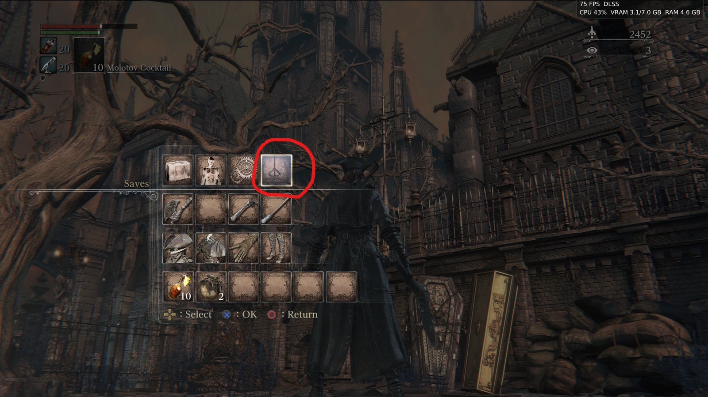

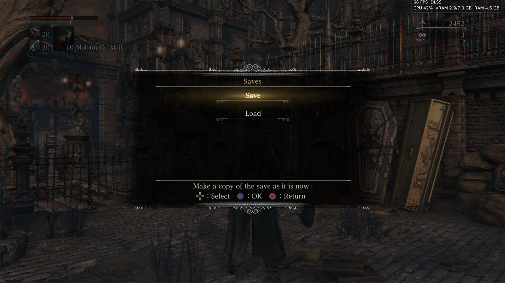

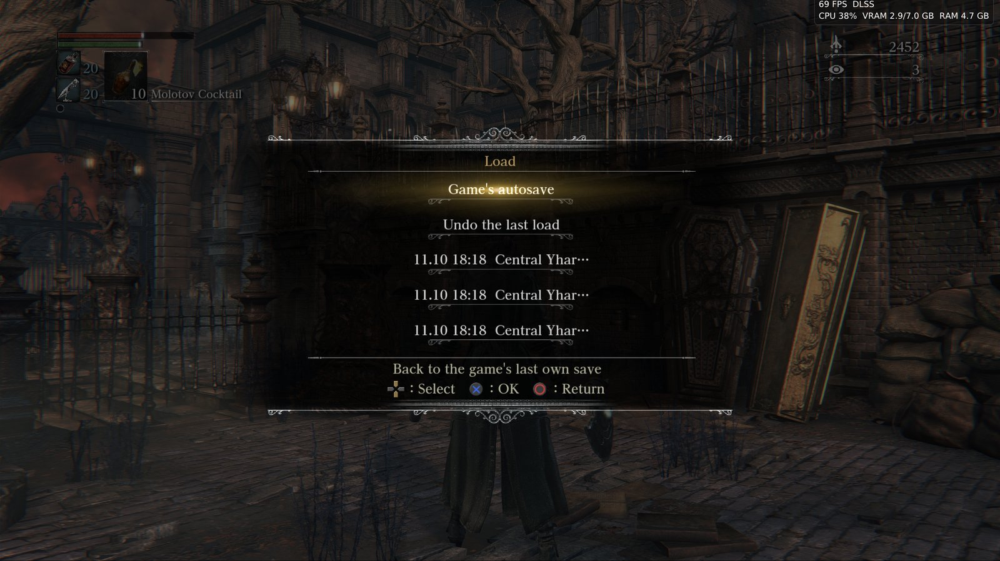

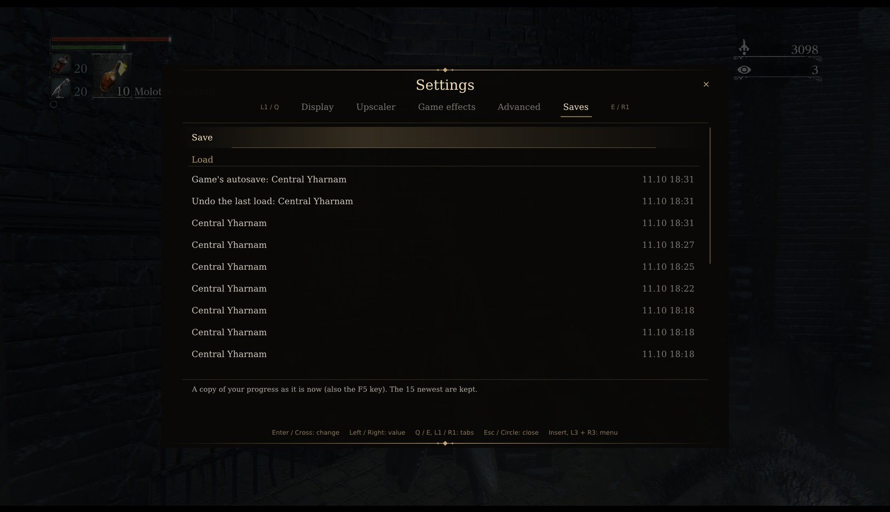

## Читы

В меню паузы игры: Options → System → **Читы**; в меню порта (**Insert**, на геймпаде
**L3 + R3**): вкладка **Читы**. Включаются сразу, без перезапуска, и остаются включёнными, пока их
не выключить (`bbport.ini`).

| Чит | Что делает |
|---|---|
| Бесконечное здоровье | Здоровье не кончается |
| Бесконечная выносливость | Выносливость не кончается |
| Бесконечные отголоски | Отголосков крови становится 99 999 999 |
| Бесконечное озарение | Озарения становится 99 999 999 |
| Бесконечные предметы | Предметов после использования остаётся 20 |
| Убийство с одного удара | Враги умирают с одного удара |

> То, что выставил чит, остаётся в сохранении и после его выключения: отголоски, озарение (много
> озарения меняет мир: враги, звуки, безумие), число предметов. Перед включением читов сделайте
> копию (**F5**): её загрузка вернёт всё как было.

## Сборка из исходников

**Установщик:** `setup.bat` в одном окне ставит MSYS2 и пакеты, скачивает исходники и собирает
порт.

Вручную:

1. Установите [MSYS2](https://www.msys2.org) в `C:\msys64`, обновите (`pacman -Syu`, пока есть
   что обновлять) и поставьте пакеты:
   ```
   pacman -S --needed git mingw-w64-clang-x86_64-{clang,lld,libc++,cmake,ninja,pkgconf,python,sdl3,boost,fmt,glslang,spirv-cross,spirv-headers,vulkan-headers,vulkan-loader,vulkan-memory-allocator,xxhash,zydis,robin-map,ffmpeg}
   ```
   `vulkan-headers` нужен версии 1.4.350 или новее.
2. `git clone --recursive https://github.com/RandomAlien0x33/bloodborne-win-native`
3. `run.bat --game-dir D:\Games\CUSA03173`: первый запуск собирает `out\bb-probe.exe`
   (`build.sh` в окружении CLANG64) и запускает игру.

## Благодарности

- **[deadinside28](https://github.com/deadinside28/bloodborne_pc)** — bbport, нативный порт, на
  котором построен этот.
- **[yumlevi](https://github.com/yumlevi/bloodborne_pc)**

## Лицензия

GPL-2.0-or-later (см. `LICENSE`). Встроенные компоненты сохраняют свои лицензии (видеоядро
shadPS4: GPL-2.0-or-later; мост DLSS в `gpu/dlss_bridge`: MIT). Бинарники NVIDIA DLSS и AMD
FidelityFX в репозиторий не входят.

NVIDIA DLSS — технология NVIDIA Corporation. Релизный пакет содержит `nvngx_dlss.dll` от NVIDIA
без изменений, по лицензии NVIDIA DLSS SDK (`out\LICENSE-DLSS-SDK.txt` в пакете).
